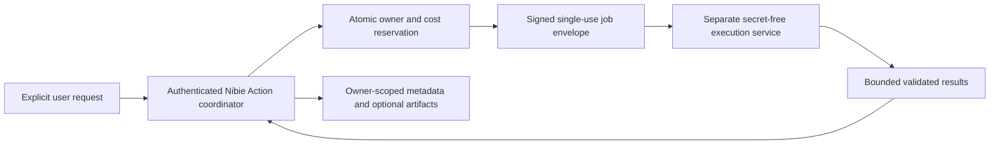

# Python sandbox V1 — Phase 0 architecture assessment

Issue [#107](https://github.com/habiibullahm/nibie-code/issues/107). Baseline: `8dc35a44c03d3b4945eda4cb0e529cb0f74d879c`. Status: **design for review; provider, costs and runtime implementation BLOCKED**. No sandbox was provisioned and no untrusted Python was executed.

## Current boundaries

The [Action registry](../../lib/actions/registry.ts) contains read-only Web/public-GitHub operations, not Python. [Action runtime](../../lib/actions/runtime.ts) supplies permission/Stop/audit boundaries but does not create an execution isolation boundary. [Usage guards](../../lib/usage/guards.ts) estimate model spend; they do not reserve sandbox infrastructure cost. Existing `.py` attachments are readable source text, never executable jobs. The [security model](../security/SECURITY_MODEL.md) and owner checks continue to apply.

A developer Docker daemon, Next.js process, Supabase function, or shell-command wrapper is not the proposed sandbox. Docker being installed in a coding task proves only development tooling availability.

## Runtime alternatives and decision

| Alternative | Isolation and operations | Decision / evidence required |
| --- | --- | --- |
| Managed execution service with verified per-job VM/microVM isolation | Provider controls host lifecycle; lower operating burden; private code/file egress and retention require review | Preferred first evaluation, conditional on documented isolation, disabled networking, secret-free jobs, deletion SLA, cancellation and enforceable pricing |
| Dedicated worker service launching isolated microVMs | More control over image, kernel, egress and lifecycle; significantly greater operational/security burden | Consider only after separate infrastructure approval, patching ownership, kernel/escape review, quota reservation and cleanup tests |
| Shared host container with mounted application environment | Shared kernel/host resources; easy credential exposure and weak tenant separation | Rejected as V1 substitute; seccomp/cgroups alone are not evidence of a safe untrusted multi-user execution boundary |
| Python in Next.js, Supabase or developer workstation | Application/developer secrets and availability exposed | Rejected |

No vendor or pricing is verified or selected. Do not implement Phase 1 until the owner approves the specific isolation, privacy, infrastructure and cost decision.

## Proposed narrow contract

- Python only, pinned signed image with reviewed standard numeric/tabular libraries. No runtime pip/npm installation, shell tool, browser control, recursive jobs or schedules.
- Server-owned envelope: authenticated owner, conversation/Room, random execution ID, expiry, request digest, approved input-object references, resource limits and a cost reservation ID. Browser/model input cannot choose a host, owner, filesystem mount, image or credential.
- Explicit confirmation for executing supplied/model-generated code and for using selected attachments. Recheck owner/Room/type/size at submission and artifact download. Ordinary chat never executes code implicitly.
- Proposed review defaults: wall time 10 seconds, CPU budget two core-seconds, memory 256 MiB, input total 1 MiB, stdout/stderr combined 256 KiB, artifact total 5 MiB and at most four artifacts. These are **unapproved design limits**, not runtime facts. Validate feasibility with representative CSV computations before choosing final values.
- Limits enforced outside Python by the execution service/supervisor: CPU/memory/pids/disk/output counters and monotonic deadline. Code-level timeouts are insufficient. Disable outbound and inbound network by host policy; DNS, metadata endpoints and local control plane must also be inaccessible.
- Empty allowlisted environment, no app/provider/OAuth secrets, no cloud instance identity, no inherited proxy credentials, no host mounts and no cross-job filesystem. Read-only base image; disposable job filesystem. No privileged container/device access. Tenant/job separation must be independently evidenced.
- Inputs are copied into the job after authorization, treated as untrusted data, and removed afterward. Reject archives and links in V1. CSV parsing has row/cell/decoded-byte limits; filenames cannot select paths.
- Validate output manifests before reading results: regular files only, bounded names/types/bytes, no symlinks/hardlinks/device files/traversal. Render text as escaped output, never trusted HTML or instructions. Generated code, input contents and raw traceback must not enter operational logs.

## Threats, controls and negative acceptance

| Threat | Required control | Evidence needed before enablement |
| --- | --- | --- |
| Secret/metadata exfiltration | Empty environment, no instance identity or mounted credentials, network denied at host boundary | Deliberate environment, DNS, metadata, localhost/control-plane and proxy access attempts fail |
| Cross-user or stale-job access | Signed expiring single-use envelope, owner/Room checks, per-job filesystem and artifact authorization | Other owner, other Room, replayed ID, revoked account and expired URL denied |
| Filesystem escape / malicious file | No host mounts; bounded validated input/output; link rejection | `../`, absolute paths, symlinks, hardlinks and archive bombs rejected without reading host files |
| Resource exhaustion / fork abuse | External CPU/memory/pids/disk/output/wall limits and global admission quota | Infinite loop, allocation bomb, subprocess storm, huge output/file creation terminated within bounds |
| Cancellation race | Persistent terminal CAS; supervisor kill and deletion acknowledgment | Stop before submit/during run/after result; late completion cannot replace cancelled outcome |
| Prompt injection through code/output | Explicit execution permission; output untrusted; tools fixed by coordinator | Output cannot authorize another tool, change limits, access another input or request secrets |
| Sandbox escape / vulnerable image | Verified isolation architecture, immutable reviewed image, patching and incident owner | Provider assurance plus independent adversarial integration/security review; no inference from Docker availability |
| Orphan job/artifact or billing leak | Deadline independent of request lifetime, periodic bounded cleanup, provider cancellation reconciliation | Lost connection/supervisor restart/failed delete tested; orphan age alarms and confirmed deletion |

## Lifecycle, privacy and cost

States: `reserved → queued → running → succeeded/failed/timed_out/cancelled/rejected`. Only the job coordinator may claim/transition states. Terminal outcomes are immutable; each transport request has a stable idempotency key. Stop prevents pending submission and sends cancellation for admitted jobs; absence of a kill acknowledgment is reported honestly and blocks additional admission if quota cannot be reconciled. A runtime wait cancellation alone does not prove external execution stopped.

Delete the execution filesystem on every terminal path and after an independent maximum lifetime. Optional artifacts may be copied only after explicit retention permission to owner-scoped storage with short-lived download URLs and a defined deletion TTL. Zero retention is the default. Audit stores IDs, image digest, sizes, limits, timings, status/error code and charged cost; code/output content requires separate consent and retention policy.

Before submission atomically reserve a pessimistic upper bound: billing quantum × maximum billable runtime/resources + startup/minimum charges + storage/egress charges. Validate the real provider's billing/cancellation model. Enforce request, owner and global daily/monthly caps and maximum concurrency; reject if price, currency conversion, quota reservation or upper bound is unknown. Set a provider/account ceiling where supported. Release or reconcile reservations on every terminal path; do not equate existing model-credit estimates with infrastructure cost authorization.

## Phase 1 approval and validation gates

1. Owner selects and approves actual provider/isolation architecture, locations/retention, price basis, billing granularity, enforced caps and operational owner. No paid provisioning during Phase 0.
2. Security review validates the exact signed image, host policy, job-envelope protocol, secret isolation and negative tests above in the approved non-production environment.
3. Contract, integration and mocked browser tests cover timeout/Stop/retry/reload, partial/rejected outcomes, authorization, malformed inputs/results and cleanup/cost races. Real execution tests require the approved provider and budget.
4. Exact-head disposable-account Preview QA and measured cost/latency envelope pass before feature enablement. No shared migrations or production deployment without separate authorization.

Rollback for this PR is documentation removal. Runtime delivery remains blocked and #107 remains OPEN. This assessment is repository-based architectural analysis, not a completed provider penetration test or Codex Security plugin scan.

